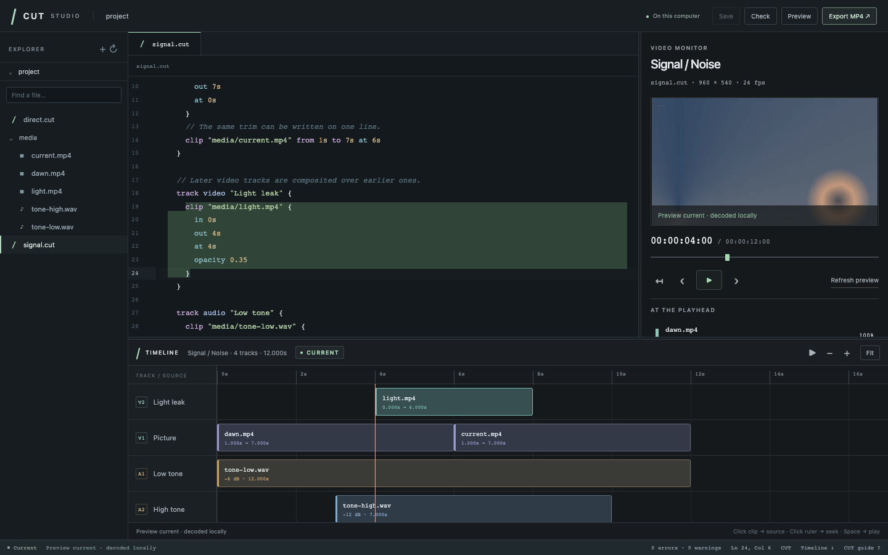

# CUT Studio

CUT Studio is a local, code-first film editor for agents. The project-scoped MCP server supports an entire edit with the Mac window closed. The window provides an optional monitor, timeline and source editor for the filmmaker. Edit a `.cut` file in the app, play the result in the monitor and click any clip in the timeline to see its code. The same editor also runs in a browser, with an optional VS Code extension and command-line renderer.

The Mac app has its own window, Dock icon and File menu. It uses the system WebKit framework for the editor and runs the local media engine in the background. Project files, previews and exports stay on your computer.



## Open the Mac app

Double-click **CUT Studio.app** in your Applications folder or in `dist/`. The app opens **After the light** on first launch. Its working copy is stored under `~/Library/Application Support/CUT Studio/`. **File → Reveal Project in Finder** opens the current project folder. Use **File → Open Project…** for your own folder or open a `.cut` film from Finder. Choose **Import Media…** to copy footage, stills, sound or subtitle sidecars into that project. **+** in the explorer creates a film. Save edits with **⌘S**.

Click **Export…**, choose **Premiere Pro project (.prproj)** and enter a path such as `output/my-film.prproj`. **Show in Finder** reveals the finished file. Keep the source media available to Premiere. To deliver a finished movie with the picture and sound baked in, choose **MP4 movie** in the same dialog.

For DaVinci Resolve Studio 21, choose **DaVinci Resolve 21 project (.drp)**. In Resolve’s Project Manager choose **Import Project**. CUT writes the file locally using Python 3.10+ and checks its native track, clip and media records. Original footage stays linked. CUT renders titles, framing, opacity and audio processing on individual affected clips. Keep any **CUT Linked Media** folder and the source assets with the project. You can change the original effects in CUT and export again. Resolve Free and other major versions are unverified.


This local build targets Apple Silicon and macOS 14 or later. The lightweight Mac build uses Node.js 22+, FFmpeg and FFprobe already installed on the machine. Native Premiere export also uses Python 3.10 or newer. Homebrew installations are discovered when launching from Finder. To rebuild the local app on a Mac with Swift tools, run `npm run package:mac`.

### Connect an AI assistant with MCP

Open the film’s project folder in the Mac app. Choose **CUT Studio → Connect an AI Assistant…**. Check the folder shown, then click **Add to Codex**. Start a new Codex chat or reconnect the server to pick up the tools. For another local MCP client, choose the JSON configuration in the same window and copy it into the client’s MCP settings. The client starts the connection when needed, including when CUT Studio is closed.

Try this with the bundled Layer study project:

> In `layers.cut`, move the light overlay to V4 and shorten it by one second. Check the edit, save it, and export a new Premiere project as `output/layer-study-v2.prproj`.

The connection reads saved films in the selected folder. It can list CUT films and media, read source, check proposed edits, inspect a timeline with numbered video and audio layers, save revised or new CUT files, and export new Resolve projects, Premiere projects, MP4 movies or Final Cut Pro 7 XML files. A saved change to the open film refreshes the editor and timeline automatically. If you have a draft open, CUT Studio keeps it onscreen and offers **Save a copy…** and **Reload**. An assistant must reread a film if another editor saves a newer revision.

The server uses local stdio and the client launches it with a fixed project folder. Your assistant provider’s own settings govern how it handles the source text, frames, audio excerpts and metadata returned by tools. MCP exports require a fresh output filename.

For the portable or source edition, set the client’s command to the full path of Node.js 22 or later. Supply three separate arguments: the absolute path to `runtime/mcp.mjs` (or `dist/mcp.mjs` after a source build), `--project`, and the absolute path to the project folder.

## Edit and review a linked cut

Open `light-study.cut` in the sample project. The first two seconds come from `scenes/opening.cut`. A second picture follows the opening, the voice enters eight frames before the join, and the score starts at zero. Both sample films use the same opening. The second version uses a different take with a tighter crop. The sample line “I knew the light would change” is original synthetic speech with a timed subtitle sidecar.

1. Open **Edit & review… → Review**, enter `reaction.start` and click **Render review**. The movie plays with sound. The contact sheet includes the last frame before the join and the first frame after it.
2. Double-click a timeline clip or use **Clip tools…** at a declaration. **Trim** accepts a signed number of frames, **Split** uses a film time, **Swap take** retains the source range, and **Close gap** takes the lanes to move. **Timing & layer** sets the name, layer and placement. Each operation updates the code in one undoable edit. Save with ⌘S.
3. Under **Footage**, choose a take and click **Contact sheet**. Click a source timecode to audition there. Search for `I knew` and click **Hear line**. Existing SRT/VTT sidecars beside the media are immediately searchable. **Index dialogue** transcribes footage locally and caches timed segments in the project. The first index downloads the 78 MB multilingual Whisper tiny model. Speech recognition can mishear words and its timestamps are segment boundaries.
4. In **Scenes**, insert another `.cut`, open a scene’s source, replace a scene or save an alternate. In **Review**, compare `light-study.cut` and `light-study-alternate.cut` at `reaction.start`, then **Play A then B**. Each version resolves the cue on its own timeline. A saved scene change refreshes its open parent. Scenes use the same frame rate and canvas as their parent. Their layers retain their numbers.
5. **Picture & sound** under **Clip** sets framing or mix. **Footage → Add to film** inserts media, titles and captions. **Export… → Premiere Pro project** lists which layers need companion media and which keep original media. Keep the generated **CUT Linked Media** folder with the project.

### Cut language

```cut
film "Lead the reaction" {
  resolution 640x360
  fps 24
  scene "scenes/opening.cut" as entrance { at 0s }
  track video "Picture" layer 1 {
    clip "media/current.mp4" as reaction { in 1s out 4s after entrance }
  }
  track video "Text" layer 2 {
    caption "I knew the light would change." { out 36f at voice.start }
  }
  track audio "Voice" layer 1 {
    clip "media/light-cue.wav" as voice { at reaction.start - 8f }
  }
  track audio "Music" layer 2 {
    clip "media/tone-low.wav" { out 5s at 0s gain -12dB duck A1 -12dB }
  }
}
```

Use `as name` on a clip, graphic or scene. Names are local to their film. Use `after name`, `at name.start` or `at name.end` with an optional signed duration, such as ` + 12f`. Forward references work. The compiler reports missing names and cycles.

For a picture clip, `crop 12,8,12,8` removes left, top, right and bottom margins in source pixels. `scale 0.5` halves its fitted size. `x 40 y -20` moves it forty canvas pixels right and twenty up from center. A still, `title` or `caption` needs an explicit `out`. Use separate video layers for overlays. On an audio clip, `duck A1 -12dB` lowers its gain while clips on A1 are playing. The time intervals follow edits to that lane.

### Editing through MCP

An agent can discover this workflow via the MCP server instructions and the JSON resource `cut-studio://reference/editing`. Use `cut_edit` with one `operation` or an ordered `operations` array (up to 64 steps on a single film). A proposal returns the changed source and exact before/after timing for named clips and scenes. Supply the proposed source to `cut_review` to inspect frames and sound before committing. Apply the batch against its base revision in one write. A failed batch leaves the source intact. Use named clips across steps because anonymous IDs follow the declaration order. Ask `cut_timeline` for `detail: "compact"` to omit parser ranges. To audition an edit to a shared scene inside its parent, send `cut_review` the parent file, its named cue, and `alternateSceneSources` mapping the child’s project-relative path to its proposed source. Each version reports the cue’s exact frame and ticks.

| Tool | What it returns |
| --- | --- |
| `cut_review` | A short movie, timecoded frames and audio around a film time or `shot.start` / `shot.end`. Supply `alternateFile` or `alternateSource` for both versions. |
| `cut_contact_sheet` | One to twelve sampled frames with source timecodes. |
| `cut_audition` | A playable excerpt from the original picture or sound file, up to fifteen seconds. |
| `cut_search_dialogue` | Matching text, file names and source times. Use `index: true` to transcribe missing takes. |
| `cut_edit` | A proposed CUT source change for `trim`, `split`, `swap`, `place`, `close_gap`, `effects` or `insert`. To commit it, supply `apply: true` and the revision from `cut_read_source`. The response includes a revision-checked undo request for `cut_save_source`. |
| `cut_export_plan` | Editable Premiere properties and the properties rendered into each companion layer. |

For example, send this to the connected assistant:

> Open the two light studies. Find “I knew”, play the take, then show me both cuts at reaction.start. In an unsaved version of the main cut, trim the reaction by three frames and tell me which Premiere tracks will use rendered media.

MCP returns PNG images and MP3 excerpts inline. Movies are linked to local files. Clients that support embedded video can request `embedMovie: true` for files up to 5 MB. The speech runtime ships in the Apple Silicon app. On other platforms use `CUT_WHISPER_CLI` with a local whisper.cpp executable. `CUT_WHISPER_MODEL` can select a previously downloaded local model.

### Browser and source editions

Requirements: **Node.js 22 or later** and **FFmpeg + FFprobe** on your PATH. FFmpeg needs the `libx264`, `aac` and `libmp3lame` encoders. Optional WebM rendering also needs `libvpx` and `libopus`. Standard full FFmpeg distributions include these. On macOS:

```sh
brew install ffmpeg
```

Windows: `winget install Gyan.FFmpeg`. Debian/Ubuntu: `sudo apt install ffmpeg`. Restart VS Code after changing PATH, or set the executable paths in CUT Studio settings.

**Browser edition.** Extract `dist/CUT-Studio-standalone.tar.gz` in a writable folder. On macOS, double-click **Launch CUT Studio.command** inside the extracted **CUT-Studio** folder. On Windows or Linux, open a terminal in that folder and run `node runtime/server.cjs`. The archive includes the editor, CLI and sample media and runs with the Node.js and FFmpeg installations above. Keep the terminal open while editing. To open your own project, pass its folder path after the server command.

**From source**, run these commands in this project folder:

```sh
npm ci
npm run sample
npm start
```

`npm start` opens CUT Studio in your default browser. The small local server listens only on `127.0.0.1`; it serves your selected project and runs FFmpeg locally. The editor has a project explorer, a CUT code editor with highlighting and diagnostics, a video monitor and a resizable timeline. No separate IDE download is required. `npm run studio` is an alias for this launch path.

Open `signal.cut` in the explorer and press play once the preview is current. Change `at 4s` to `at 5s` in the Light leak track to see it move immediately and the composition refresh. On macOS you can also double-click **Launch CUT Studio.command** beside this README. Save with **Cmd+S / Ctrl+S**. Render MP4 from the editor toolbar; progress and cancellation stay in the app.

To open your own local project folder:

```sh
npm start -- "/absolute/path/to/my-film-project"
```

To start a film, place footage or audio inside this folder and click **+ (New film)** in the explorer. The editor creates an editable CUT document. Use the explorer’s refresh button after copying in more media. Keep the film’s source and media together inside this folder or its subfolders. In the standalone editor, media references and output paths must resolve inside the selected project. The optional extension and CLI can also use local media elsewhere on your computer. Stop the local server with Ctrl+C in the terminal. The server uses a per-launch token and does not expose a network service to other computers.

### Optional VS Code workflow

The extension is available when you want VS Code's native editor and explorer. It requires VS Code 1.96 or later. From an installed VS Code, open this repository and press **F5**, selecting **Run CUT Studio**. Or run:

```sh
npm run studio:vscode
```

This optional launcher downloads an official VS Code build into `.vscode-test/` if one is not already there (approximately 340 MB). It uses a dedicated development profile and does not replace your system editor. Set `CUT_VSCODE` to a full executable path to select a particular build.

To install the extension normally:

```sh
npm run package
```

In VS Code, run **Extensions: Install from VSIX…** and select `cut-studio-0.1.0.vsix`. Open a folder with your `.cut` document and media, and trust the local project if prompted. The native explorer and source editor remain available beside the monitor; the timeline opens in the bottom panel and can be hidden or reopened with **CUT: Show Timeline**.

## A small language for exact edits

```cut
film "My Short Film" {
  resolution 1920x1080
  fps 24

  track video "Main" {
    clip "footage/opening.mp4" {
      in 1m00.052s
      out 1m14.750s
      at 0s
    }
    clip "footage/street.mp4" from 3s to 10s at 15s
  }

  track video "Rain" {
    clip "footage/rain.mp4" {
      in 0s
      out 5s
      at 5s
      opacity 0.4
    }
  }

  track audio "Music" {
    clip "audio/score.wav" {
      at 0s
      gain -12dB
      fade_in 2s
      fade_out 3s
    }
  }
  track audio "Dialogue" {
    clip "audio/voice.wav" { at 4s gain -3dB }
  }
}
```

Both block and concise clips have the same internal representation. Use `//`, `#`, or `/* … */` comments. Whitespace is flexible. Strings use double quotes with JSON escapes; use forward slashes in paths, including on Windows. Relative paths resolve beside the `.cut` document, independent of your terminal's working folder. Only local files are accepted.

| Property | Meaning | Default |
| --- | --- | --- |
| `resolution` | Output width × height, even dimensions | `1920x1080` |
| `fps` | Integer, decimal, or rational output frame rate | `24` |
| `in` | Source media start boundary | `0s` |
| `out` | Source media end boundary, **exclusive** | Remaining source duration |
| `at`, `after` | Absolute time, a named start/end plus a signed offset, or the end of another shot | `0s` |
| `opacity` | Video layer alpha, from 0 to 1 | `1` |
| `gain` | Audio level in decibels | `0dB` |
| `fade_in`, `fade_out` | Audio fade durations relative to the clip | `0s` |

Video tracks carry picture only. To use the sound from a video file, add that same path to an **audio** track. Later video tracks appear over earlier video tracks. Their empty portions and letterbox padding are transparent; uncovered output is black. Audio tracks mix independently at the requested gain; the renderer does not automatically normalize the mix. Keep headroom when mixing loud sources.

Same-track overlaps are errors. Put simultaneous clips on different tracks. Film duration is the latest clip end across all tracks, so audio can continue over black after the picture ends. Each fade must fit within its clip. There are no implicit transitions, playback speed changes, or drag-to-edit timeline operations.

### Choose the layer in code

Video and audio have separate layer numbers. Higher video layers cover lower ones. In this example the first clip stays on V1, the second moves to V3 and the sound plays on A2. Changing the number moves the clip in the timeline and in the exported sequence.

```cut
track video "Picture" layer 1 {
  clip "media/dawn.mp4" from 0s to 6s at 0s
  clip "media/light.mp4" { in 0s out 4s at 1s layer 3 opacity 0.35 }
}
track audio "Sound" layer 2 {
  clip "media/tone-high.wav" { at 1s gain -12dB }
}
```

Use `layer N` in a track header, inside a clip, or after a concise clip declaration. The clip setting takes precedence. Explicit numbers range from 1 to 256. Unnumbered track declarations use the next available layer of that kind. Separate declarations that target the same layer share its overlap checks. A number left unused between occupied layers creates an empty lane, as shown in [the layer study](examples/layers.cut).

## Timing

Accepted forms include `52s`, `1m00.052s`, `1h02m03.5s`, `00:01:00.052`, `120f`, and non-drop `00:01:00:12`. Frame counts and framecodes use the film's FPS, even if `fps` appears after a track. Use `fps 24000/1001` or `fps 30000/1001` for exact NTSC rates; `23.976` and `29.97` are literal decimal rates. Drop-frame timecodes using `;` are rejected with an explanation.

The core stores **integer ticks at 35,280,000 ticks per second**. This represents common 44.1/48 kHz samples and standard integer/NTSC frame durations exactly. Timestamp parsing and frame conversion use integer rational arithmetic. Decimal values beyond tick precision round once, with no cumulative addition of floating-point seconds. Supported times are bounded by JavaScript's safe integer range.

Video `in`, `out`, and `at` resolve to the nearest **output frame grid**, with half-frame ties rounding up; a rounded out point is capped to the last whole frame within the source. The editor and CLI report every adjustment as a warning. Clip duration is the resolved `out - in`; out is exclusive. Audio trims retain integer-tick precision and are converted to sample positions for the FFmpeg trim and mix filters. The final video is padded to a whole output frame. Render ranges use the same output frame grid.

## Editing and preview workflow

Opening a local `.cut` file activates syntax highlighting, completions, diagnostics and the monitor in either editor. The timeline is parsed synchronously after each edit, before media probing. File checks and rendering happen in the background. Clicking a clip reveals its source definition; clicking or dragging the ruler scrubs the monitor. Video and audio tracks use distinct colors.

The monitor explicitly distinguishes **out of date**, **checking**, **rendering**, **current**, and **error** states. Editing source immediately pauses and invalidates the old preview. Superseded FFmpeg jobs are cancelled. Invalid source does not silently keep playing an older edit as though it were current.

A single opaque, full-resolution, constant-frame-rate video clip with no audio tracks can play directly when its container and codec are supported, with source-trim boundaries enforced. Other compositions use low-resolution segments, up to 960×540. The Mac app previews H.264/AAC. The VS Code and browser editions use H.264/MP3 for playback compatibility; the engine also supports VP8/Opus WebM. The default segment is eight seconds around the playhead; playback requests the next segment at the boundary. A brief pause while a new segment renders is expected. Cached segments include the compiled edit, source file fingerprints, range, render version, output format and FFmpeg path in their identity. Unchanged segments can be reused. The project-local `.cut-cache/` folder may be deleted at any time while rendering is stopped.

The optional VS Code extension uses MP3 preview audio because [VS Code webviews do not support AAC audio in MP4](https://code.visualstudio.com/api/extension-guides/webview#supported-media-formats). Final MP4s use H.264/AAC. Short preview files load fully before decoding, with cancellation and Blob URL cleanup, to avoid partial local-resource streaming failures. The extension watches for local media changes. In the standalone editor, use **Check** after replacing media in an external application. Rendering is disabled in untrusted workspaces.

Commands in the Command Palette (`Cmd+Shift+P` on macOS, `Ctrl+Shift+P` on Windows/Linux):

| Command | Action |
| --- | --- |
| **CUT: Open Video Monitor** | Reveal the monitor beside your source |
| **CUT: Show Timeline** | Reveal the bottom timeline |
| **CUT: Check Film** | Validate syntax, media and resolved timing |
| **CUT: Render Preview** | Refresh the playhead's preview segment |
| **CUT: Render Film to MP4** | Choose a destination and render the film, with cancellable progress |
| **CUT: Render Section to MP4** | Enter a start time and an exclusive end time, then choose the MP4 destination |
| **CUT: Export DaVinci Resolve Project** | Save an editable native Resolve 21 Studio project (.drp) |
| **CUT: Export Premiere Pro Project** | Save an editable native `.prproj` sequence |
| **CUT: Export Final Cut Pro 7 XML** | Export an editable interchange sequence with limitation warnings |

With the monitor or timeline focused: **Space** toggles playback, **Left/Right** step a frame, **Home** goes to the beginning. Use the monitor scrubber or timeline ruler to seek. Settings: `cut.ffmpegPath`, `cut.ffprobePath`, `cut.autoPreview`, and `cut.previewSegmentSeconds` (1–30).

## Command-line editing

After `npm run build`, use `npm run cut -- …` or `node dist/cli.cjs …`. Optional: `npm link` adds `cut` to your shell.

```sh
cut check film.cut
cut timeline film.cut
cut timeline film.cut --json
cut preview film.cut
cut preview film.cut --from 10s --to 18s --output preview.mp4
cut render film.cut --from 10s --to 25s
cut render film.cut --output movie.mp4
cut export film.cut --output movie.drp
cut export film.cut --output movie.prproj
cut export film.cut --output sequence.xml
```

`check` checks source, media existence, stream types, source bounds, fades and overlaps. `timeline` prints source trims and absolute placements. `preview` defaults to the first eight seconds and returns a cached low-resolution MP4 path. `render` exports the whole film or a selected section, shifted to start at zero while preserving clip synchronization and fade envelopes. The default output is the input filename with `.mp4` in place of `.cut`. Progress and diagnostics go to stderr; paths and summaries go to stdout. Errors return exit code 1; cancellation returns 130. Press Ctrl+C to cancel a render; temporary partial output is removed.

Set `CUT_FFMPEG` and `CUT_FFPROBE`, or use `--ffmpeg` / `--ffprobe`, for custom executable paths. All processes receive argument arrays, without a shell. Output must differ from source assets and the CUT document; final output is atomically replaced only after a successful render.

## Generated sample and tests

`npm run sample` creates three animated procedural gradient videos and two synthesized WAV tones under `examples/media/`. They are generated locally with FFmpeg. The ready-to-run archive already includes them. `examples/signal.cut` uses both clip syntaxes, two video tracks, opacity, two simultaneous audio tracks, unequal gains and fades.

```sh
npm run typecheck
npm test
npm run test:vscode
npm run cut -- check examples/signal.cut
npm run cut -- render examples/signal.cut --output examples/output/signal.mp4
```

The automated suite includes parser/time tests, exporter tests, real FFmpeg renders with decoded pixel and audio checks, preview caching and cancellation, and command-line integration. `test:vscode` downloads/runs a real VS Code extension host and checks activation, language registration, command registration, panels, completions, missing-file diagnostics and recovery after an unsaved edit. The HTTP tests start an isolated studio on a local port, exercise concurrent saves and export cancellation, and inspect real preview and export streams. A graphical desktop is needed for the VS Code suite. FFmpeg integration tests deliberately fail if the required local tools are missing.

## Independent core and interchange

| Module | Responsibility |
| --- | --- |
| `src/core/` | Source ranges, parser, exact time, validation, resolved timeline |
| `src/engine/` | Local process execution, media probing, FFmpeg composition, proxy cache |
| `src/cli/` | Terminal command adapter using the same compiler and renderer |
| `src/standalone/` | Local project service, CodeMirror editor, export dialog and explorer |
| `macos/` | Native app window, Finder integration, media import and local runtime lifecycle |
| `src/extension/`, `media/` | Optional VS Code integration and shared monitor/timeline presentation |
| `src/exporters/` | Editable Premiere Pro projects and Final Cut Pro 7 interchange XML |

The browser editor, optional extension and CLI use the same parser, validator and FFmpeg renderer. The compiled standalone runtime is independent of VS Code and npm. To rebuild its distribution, run `npm run package:standalone` after generating the sample media.

The native Premiere writer creates a `.prproj` with an editable sequence, numbered tracks and linked source media. See [Premiere export notes](docs/premiere.md) for media and effect support.

The FCP 7 `xmeml` XML exporter describes editable tracks, media paths, source in/out, sequence positions, resolution and integer/standard NTSC rates. It preserves layer order. It reports audio precision loss, mixed-frame-rate conformance and omitted opacity/gain/fades; bake these with the renderer when a matching appearance or mix is required. It does **not** claim that Premiere reproduces unsupported effects. Actual Premiere import validation remains separate from structural XML tests.

[OpenTimelineIO's community FCP adapter](https://github.com/OpenTimelineIO/otio-fcp-adapter) is a possible later interchange route. OTIO itself is not a media renderer, and adapters have different property coverage. See [interchange notes](docs/interchange.md) for the research and compatibility boundaries.

## Current limits

- Segment playback can pause at uncached boundaries. This is a proxy-based editor, with no full real-time compositing engine or ahead-of-playhead render queue.
- Double-click a timeline clip to edit its CUT declaration. Freeform dragging, animated transforms, transitions, grading and retiming are future work.
- Rendering currently supports the first video/audio stream in each referenced file, mono/stereo mixing to 48 kHz stereo, and SDR output. No HDR management, multichannel routing, editable timed-text interchange, image sequences, VFR-aware source framecode or multicam tools.
- Media metadata and proxy invalidation use local file path, size and filesystem modification/change times. They avoid reading whole media files to compute a hash. Metadata-preserving external file replacements require a manual recheck or cache removal.
- The Final Cut Pro 7 XML interchange exporter reports omitted effects. Choosing MP4 preserves the rendered CUT result.

Licensed under MIT.
